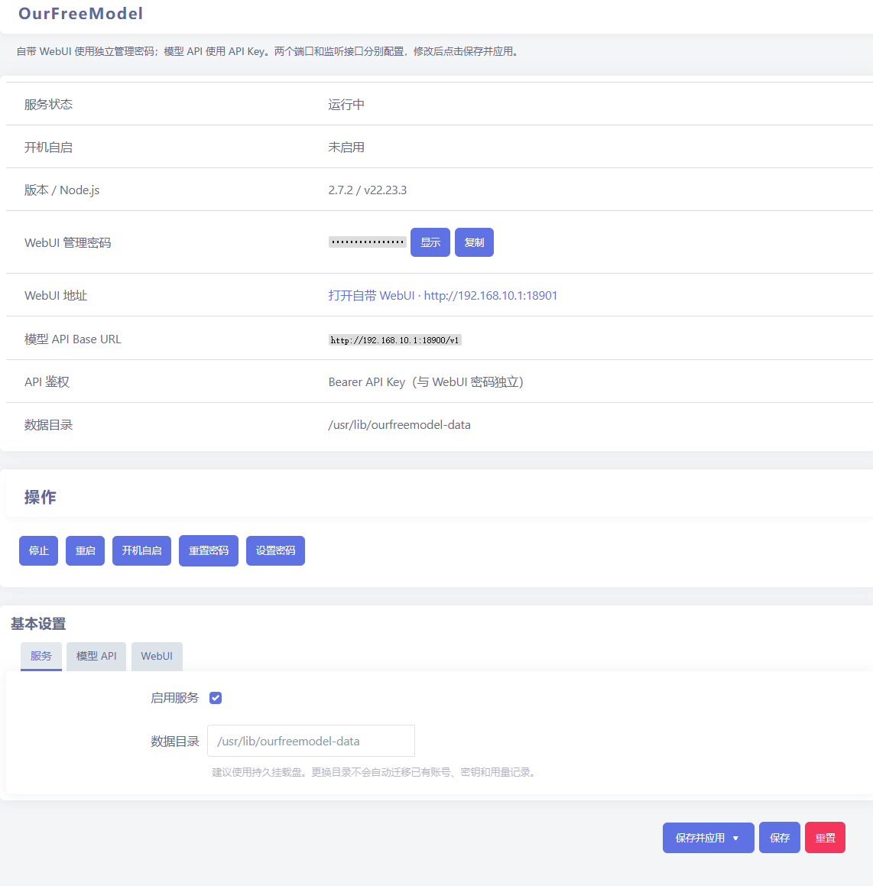

# dsh-our-free-model-for-openwrt

将 [dsh-our-free-model](https://github.com/Ebony-Vinyl/dsh-our-free-model) 的独立 Node.js 服务移植到 OpenWrt，提供独立的 OpenAI 兼容 API、带管理密码的自带 WebUI，以及 OurFreeModel LuCI 菜单。

仓库地址：[ftkey/dsh-our-free-model-for-openwrt](https://github.com/ftkey/dsh-our-free-model-for-openwrt)。主程序包名和 APK 文件名前缀为 `dsh-our-free-model-for-openwrt`，另有可选的 `dsh-our-free-model-bun` 运行时包。这是安装到现有 ROM 的软件包，不会生成或重命名整个路由器固件镜像。

## 界面预览

LuCI → 服务 → OurFreeModel。页面从上到下依次是标题与说明、状态表、操作按钮和基本设置；WebUI 管理密码默认掩码显示，点「显示」可临时回显。



## GitHub Actions 编译 APK / IPK

使用 ImmortalWrt snapshot SDK 的同一套 `BuildPackage` 配方生成 APK 或 IPK，通过 `CONFIG_USE_APK` 切换格式。APK 使用 SDK 的 `apk adbdump` 核对元数据；IPK 检查控制信息、运行时和 LuCI 安装内容。下载 SDK 时检查 SHA256，SDK 提供签名公钥时验证 APK 签名。

默认同时构建：

| Actions 平台 | SDK target/subtarget | 用途 |
| --- | --- | --- |
| arm64-ipq60xx | qualcommax/ipq60xx | 太乙 ER1、亚瑟等 IPQ60xx 设备 |
| amd64 | x86/64 | x86_64 软路由 |

ARM64 目标依据 [ER1-WRT-CI 的 ROM 配置](https://github.com/ftkey/ER1-WRT-CI/blob/main/.github/workflows/build-firmware.yml) 选择。ROM 使用 VIKINGYFY/immortalwrt，而此处和参考项目一样使用官方 ImmortalWrt snapshot SDK；两者并非同一构建，安装时仍需核对设备架构、APK 格式和 Node.js 版本。

1. 将**本目录内容**放在新仓库根目录，确保包含隐藏的 `.github/`、根 `Makefile`、`files/` 和 `payload/`。不要将整个项目目录嵌套一层上传，也不要上传 `dist/`。
2. 推送到 `main` **不会**自动触发编译；需要编译时在 **Actions → Build APK / IPK → Run workflow** 手动运行（默认勾选 `sync_upstream`，会先同步上游），或推送 `v*` 标签。PR 只构建对应提交。定时运行同样会同步上游。
3. 手动运行时选择「打包格式」：`apk` 或 `ipk`，默认 `apk`。定时和标签构建默认使用 APK。
4. 编译完成后下载 Artifacts 中对应格式、平台的 ZIP，如 `dsh-our-free-model-for-openwrt-ipk-arm64-ipq60xx`。每个平台包含主程序与 `dsh-our-free-model-bun` 两个软件包、`SHA256SUMS`、对应的元数据文件（`APK-METADATA.txt`/`IPK-METADATA.txt` 与 `BUN-METADATA.txt`）、`PACKAGE-FORMAT`、`SDK.config`、SDK 下载校验列表、移植版本信息及源提交 SHA。
5. 需要发布到 Releases 时，手动运行默认勾选 `publish`。发布标签按包版本命名，如 `apk-2.7.2-r5` 或 `ipk-2.7.2-r5`（`<格式>-<上游版本>-r<发布号>`，来自 `payload/PORT-VERSION.json` 与 `Makefile` 的 `PKG_RELEASE`）；同一版本重复编译会覆盖同一个 Release，不新增标签。该标签不匹配 `v*`，不会反过来触发构建。也可推送 `v*` 标签，此时直接使用该标签名。取消勾选 `publish` 则只上传 Artifact。无需配置额外 Secret，发布使用仓库内置 `GITHUB_TOKEN`。

软件包使用 SDK 命名规则，例如 `dsh-our-free-model-for-openwrt-<版本>-r<发布号>.apk` 或 `dsh-our-free-model-for-openwrt_<版本>-r<发布号>_all.ipk`，实际版本以 Artifact 为准。每次构建同时产出主程序与可选的 `dsh-our-free-model-bun`（Bun 运行时，按目标架构打包，解压后约 95 MiB）；Bun 包不随主程序强制安装。主程序载荷是纯 JS，配方使用 `PKGARCH:=all`；Bun 包使用目标架构。两个平台仍分别使用各自的 SDK 处理依赖和验证，产物按平台分开保存。不会打包 Node.js，需要从固件软件源安装。

## 自动同步上游

上游固定为 [Ebony-Vinyl/dsh-our-free-model](https://github.com/Ebony-Vinyl/dsh-our-free-model)，跟随该仓库的默认分支。

- 定时每 24 小时检查一次，北京时间约**每天 08:17**；GitHub 定时任务可能延迟。
- 检测到新的上游提交后，刷新 `payload/`（包括上游已提交的预编译 Web UI）和根 `LICENSE`，提交到本仓库 `main`，随后直接在同一次工作流中编译两种平台。
- 上游版本不变时自动递增 `PKG_RELEASE`；版本升级时重置为 `1`。版本回退或必要文件缺失会报错停止。
- 定时运行时，如果上游没变化且当前仓库提交已有成功运行记录，则跳过编译；没有成功记录时继续构建，因此首次失败后可在后续定时运行中重试。手动运行始终编译。
- ARM64 和 AMD64 构建固定使用同步后确定的同一个仓库提交；`SOURCE-SHA`、`PORT-VERSION.json` 分别记录移植仓库与上游提交。
- 手动运行默认同步上游（取消勾选 `sync_upstream` 则只编译当前快照）；并默认发布 Releases（取消勾选 `publish` 则只上传 Artifact）。定时运行和标签构建默认只上传 Artifact。
- 已知上游同步可能被 GitHub 的 OAuth 凭据推送保护拦截。同步后会把 Gemini CLI 的公开凭据常量还原为拼接写法（`scripts/strip-gemini-secrets.mjs`）以避免拦截；仍有明文残留时报错停止，不推送被拒的提交。

将新版工作流和 `scripts/sync-upstream.sh` 一起推送到 `main` 后生效，无需额外 PAT 或 Secret。工作流使用内置 `GITHUB_TOKEN` 写回同步结果；`main` 的分支规则需允许该机器人提交。

同步产生的提交由机器人通过 `GITHUB_TOKEN` 推送，本流程直接把该提交交给后续编译任务，不依赖第二次触发。参见 [GitHub 工作流触发规则](https://docs.github.com/en/actions/how-tos/write-workflows/choose-when-workflows-run/trigger-a-workflow)。

## 安装与启动

本移植按上游要求使用 **Node.js 22.19+（22 系列）或 24+**。Node.js 20 未做兼容保证；MIPS32 没有可用的现代 Node.js 支持。先在路由器上检查：

```sh
apk --version
apk update
apk add node
node --version
apk --print-arch
```

将 ZIP 解压后的 APK 上传到路由器，再执行：

```sh
# 文件名按实际下载结果替换；主程序可单独安装
apk add --allow-untrusted ./dsh-our-free-model-for-openwrt-2.8.3-r5.apk
# 仅使用 OpenCode 免费模型时再安装 Bun 运行时（独立可选包）
apk add --allow-untrusted ./dsh-our-free-model-bun-1.4.4-r1.apk
/etc/init.d/ourfreemodel enable
/etc/init.d/ourfreemodel start
# 首次安装会自动生成 16 位随机 WebUI 密码，在 LuCI → 服务 → OurFreeModel 中查看并复制。
# 也可通过 SSH 交互设置（输入不回显，不会重启模型 API）：
/etc/init.d/ourfreemodel password
/etc/init.d/ourfreemodel status
logread -e ourfreemodel
```

APK 用于采用 `apk` 的固件；IPK 用于采用 `opkg` 的固件。IPK 安装示例：

```sh
opkg update
opkg install ./dsh-our-free-model-for-openwrt_*.ipk
# 可选：免费模型车道需要
opkg install ./dsh-our-free-model-bun_*.ipk
```

Bun 包是**可选独立包**：不安装时其他模型通道正常，只有 OpenCode 免费通道会提示缺少 Bun；安装后无需改配置（`free_transport` 默认 `auto` 会自动发现）。也可以在 LuCI 的「系统 → 软件包」页面上传本地 `.apk`/`.ipk` 安装两个包，或直接在 **服务 → OurFreeModel** 页面点击「下载并安装 Bun」按需下载官方 Bun 运行时；已安装后可点击「移除 Bun」，无需 SSH。

选择 IPK 不会降低运行时要求，仍需要 Node.js 22.19+ 或 24+。部分旧版固件软件源只有 Node.js 20，必须先解决匹配的 Node 依赖；snapshot SDK 生成的 IPK 也需要与目标固件的依赖 ABI 匹配。

这是独立 SDK 构建的第三方 APK，ROM 默认不信任其签名，因此安装时使用 `--allow-untrusted`。依赖无法满足时先核对 ROM 软件源；不要强制跳过 Node.js 依赖。旧 `mkapk.py` 手工生成的 `dist/*.apk` 不属于 SDK 产物，请重新通过 Actions 编译；该入口现已停用。

### 免费模型车道与 Bun

上游 2.8.x 的 OpenCode 免费推理通道要求本机 Bun；用 Node 通道请求会被上游按非 OpenCode 客户端限流（返回 “Free usage limit reached”）。本仓库单独构建 `dsh-our-free-model-bun`（不随主程序强制安装），把官方 Bun musl 运行时安装到 `/usr/lib/ourfreemodel/bin/bun`；主程序启动时按 `bun_path` 和 PATH 自动发现。相关 UCI 配置：

```sh
# auto（默认）：找到 Bun 就用 Bun；bun：强制 Bun；node：强制旧 Node 通道（会触发上游限流）
uci set ourfreemodel.main.free_transport='auto'
uci set ourfreemodel.main.bun_path='/usr/lib/ourfreemodel/bin/bun'
uci commit ourfreemodel
/etc/init.d/ourfreemodel restart
```

除安装独立软件包外，LuCI 页面也提供运行时管理：

- 「下载并安装 Bun」读取主程序自带的 `/usr/lib/ourfreemodel/bun-assets.json`（与 Actions 构建共用 `scripts/bun-assets.json`），按路由器架构选择官方 `bun-linux-<arch>-musl.zip`，从 `github.com/oven-sh/bun/releases` 下载并校验清单中的 SHA256，解压出单个 `bun` 文件到 `/usr/lib/ourfreemodel/bin/bun`。
- 下载在独立后台进程中完成，LuCI 轮询状态显示进度，避免大文件超出 rpcd 调用时长；安装和移除都不需要重启服务，下一请求会自动重新发现 Bun。
- 「移除 Bun」只删除该运行时文件及其版本标记，不影响主程序、其他模型通道或已保存的配置。若 Bun 是通过 `apk`/`opkg` 安装的独立包，建议改用 `apk del dsh-our-free-model-bun` 或 `opkg remove dsh-our-free-model-bun`，让包管理器同步元数据。
- 下载需要路由器能直连 GitHub，并预留约 150 MiB 的临时空间；官方归档解压后约 95 MiB。LuCI 使用 Node 内建 `fetch`，不会读取 `HTTP_PROXY`/`HTTPS_PROXY`；只能通过代理访问 GitHub 时，请改用上面的独立 Bun 软件包离线安装。

服务入口为 `/usr/lib/ourfreemodel-access/cli.mjs`。上游运行时只监听本机临时端口；面向用户提供两个独立入口。`/etc/config/ourfreemodel`、`/etc/ourfreemodel-access.json` 声明为升级保留配置，均不含明文密码。`/etc/ourfreemodel-access.json` 保存 WebUI 密码的 scrypt 随机盐和哈希；密码由随机生成时，另一份明文保存在 `/etc/ourfreemodel-webui-secret`（`0600`，仅 root 可读），供 LuCI 显示和复制，手动设置密码时会删除该文件。首次安装或密码文件缺失时自动生成 16 位随机密码，因此 WebUI 开箱即可登录；API 始终独立运行，不依赖 WebUI 密码。

服务名称、UCI 配置和安装路径统一使用 `ourfreemodel`：`/etc/init.d/ourfreemodel`、`/etc/config/ourfreemodel`、`/usr/lib/ourfreemodel`。默认数据目录为 `/etc/ourfreemodel`，安装时会自动写入 `/etc/sysupgrade.conf`，因此保留配置升级（`sysupgrade -c`）不会丢失账号、密钥与用量记录；数据量较大时建议改到持久挂载盘。升级时自动迁移旧 `ofm` 服务的配置、WebUI 密码、默认数据目录及开机自启链接；自定义数据目录保持原路径。

## LuCI 菜单

安装后进入 **服务 → OurFreeModel**。LuCI 菜单和页面布局采用 [OpenWrt 官方应用示例](https://github.com/openwrt/luci/tree/master/applications/luci-app-example) 的菜单、JavaScript 视图和 ACL 结构。本包依赖 `luci-base`、`rpcd` 和 `rpcd-mod-luci`，安装时会刷新 RPC 服务和 LuCI 菜单缓存。菜单提供：

- 运行状态、版本、Node.js 版本、数据目录、WebUI 链接和实际 API Base URL；状态表中直接显示当前随机 WebUI 密码并提供「复制」按钮。
- 启动、停止、重启、启用/关闭开机自启，以及总服务启用开关。
- 「重置为随机密码」一键生成新的 16 位随机密码并显示在状态表中；「手动设置 WebUI 密码」用于自定义密码。密码不会写入明文 UCI，也不会出现在命令参数中。重置注销旧管理会话，只重新加载 WebUI，不重启模型 API、不更换 API Key。
- 分别配置 **API 端口、WebUI 端口**，以及两个入口各自的逻辑网络接口和本地 IP。
- 数据目录和 WebUI HTTPS 反向代理来源配置。更改数据目录不会自动迁移原目录内容。

配置修改后点击「保存并应用」。两个端口必须不同。网络接口上线、下线或地址变更时，服务会按所选接口重新加载；选中的接口没有可用 IP、指定 IP 不属于该接口或端口被占用时，该入口停止并显示原因，不会回退到监听所有接口。另一入口仍可独立运行。

## WebUI 与模型 API

| 入口 | 默认地址（lan 接口本地 IP） | 鉴权 |
| --- | --- | --- |
| 自带 WebUI | `http://<路由器LAN IP>:18901` | WebUI 管理密码 |
| 模型 API | `http://<路由器LAN IP>:18900/v1` | `Authorization: Bearer <API Key>` |

WebUI 密码保护的是上游自带管理界面（概览、模型清单、用量统计、账号渠道、API 接入、服务设置等）。首次安装会生成 16 位随机密码并显示在 LuCI 状态表中，点「复制」即可用于登录。验证成功后直接进入原 WebUI；管理资源及管理接口同样要求登录。管理会话采用 HttpOnly、SameSite=Strict Cookie，8 小时过期；点击 WebUI 退出会注销会话。连续输错 5 次后，该来源 IP 暂停验证 15 分钟。忘记密码时，在 LuCI 点「重置为随机密码」查看新密码，或在 SSH 中执行 `/etc/init.d/ourfreemodel password` 手动设置。

模型 API **不要求 WebUI 密码、不要求 HTTP Basic、不要求先登录浏览器**，可直接配置到标准 OpenAI 兼容客户端。API Key 在自带 WebUI 的「API 接入」中查看或轮换，轮换后旧 Key 立即失效。API 端口不提供 WebUI 或管理接口，不能用 API Key 登录 WebUI；WebUI 端口也不承担模型转发。示例：

```sh
curl -H 'Authorization: Bearer <API Key>' \
  http://<路由器LAN IP>:18900/v1/models
```

转发支持原有 OpenAI、Anthropic 和 Gemini 兼容路由，并保留流式响应。两个端口及监听地址以 LuCI 实际状态为准，WebUI 中显示的 API Base URL 也会指向独立 API 入口。上游额外 LAN 中继由本包的独立 API 入口替代；监听配置统一在 LuCI 中维护，避免再开第三个入口。

默认两个入口都绑定 `lan`。可以分别选择 `loopback`、`lan` 或其他逻辑接口；留空本地 IP 时优先使用接口 IPv4，没有 IPv4 时使用 IPv6，也可指定该接口的某个本地 IP。显式选择「所有本地接口」才会监听 `0.0.0.0`。这是按接口的本地 IP 绑定监听，防火墙入站规则仍由路由器原配置控制，本包不会自动放行 WAN。

如需映射给外部模型客户端，只映射 **API 端口**，使用 API Key。HTTP 不加密传输的密码或 Key，跨不可信网络时应使用 HTTPS、VPN 或 SSH 隧道。WebUI 支持 HTTPS 反向代理：在 LuCI 设置「WebUI HTTPS 外部来源」为 `https://<域名>`（不含路径），代理转发到本机 WebUI 端口；网关据此检查来源并设置 Secure Cookie，不信任客户端自行提供的 `X-Forwarded-*` 头。

UCI 示例（端口和绑定接口也可直接在 LuCI 修改）：

```sh
uci set ourfreemodel.main.api_port='18900'
uci set ourfreemodel.main.api_interface='lan'
uci set ourfreemodel.main.web_port='18901'
uci set ourfreemodel.main.web_interface='lan'
uci set ourfreemodel.main.data_dir='/mnt/ourfreemodel'
uci commit ourfreemodel
/etc/init.d/ourfreemodel restart
```

只通过 SSH 使用管理页时，将 `web_interface` 改为 `loopback`，并在电脑上运行 `ssh -L 18901:127.0.0.1:18901 root@<路由器IP>`，然后访问 `http://127.0.0.1:18901`，仍需 WebUI 密码。API 可以继续独立绑定 `lan`。

## 本地维护

```text
.github/workflows/Build-APK.yml  定时同步、编译与可选发布
Makefile                       OpenWrt 主程序配方（Bun 为可选独立包）
scripts/bun-assets.json        Bun 版本与两架构官方 musl 归档 SHA256（同时装入主程序供 LuCI 下载）
openwrt/dsh-our-free-model-bun/  Bun 运行时软件包配方
scripts/build-package.sh        APK/IPK SDK 编译、格式校验及产物收集（主程序 + Bun）
files/usr/lib/ourfreemodel-access/bun.mjs  LuCI 按需下载、校验、解压与移除 Bun 运行时
scripts/build-apk.sh            保留原 APK 构建命令
scripts/inspect-ipk.py          IPK 控制信息与安装内容校验
scripts/sync-upstream.sh        检测上游提交、刷新载荷及更新发布号
build-payload.sh               从上游工作树刷新运行时快照
payload/                       随仓库提交的运行时及预编译 Web UI
files/etc/init.d/ourfreemodel            procd 启动脚本
files/etc/config/ourfreemodel    UCI 配置
files/etc/ourfreemodel-access.json       密码哈希占位（首次启动写入随机密码的 scrypt 哈希）
files/usr/lib/ourfreemodel-access/       WebUI 密码、独立 API、接口解析及 LuCI 后端
files/www/luci-static/          OurFreeModel LuCI 配置页
files/usr/share/luci/menu.d/    LuCI 菜单注册
files/usr/share/rpcd/acl.d/     LuCI 读写权限
files/usr/libexec/rpcd/         受 ACL 保护的服务控制与密码重置 RPC
tests/                         WebUI、API、接口绑定及 LuCI 回归测试
docs/luci-ourfreemodel.png     README 界面截图
LICENSE                        上游 MIT 许可
```

工作流只在手动运行、定时任务和 `v*` 标签时编译；分支推送不再触发。定时或明确请求同步时，先保存上游更新，再使用确定提交的 `payload/` 编译。两个平台不会各自拉取上游。`payload/PORT-VERSION.json` 记录上游版本和来源提交。当前约 42 MiB，保留上游 `src/engine-parts` 分片；上游 Magpie 二进制目前只有 Windows 版本，本包不提供其 Linux 引擎，不能视为所有平台专用功能均可用。

日常更新由 Action 自动完成。如需在本地手动更新（上游已有预编译 `packages/standalone/web/` 时）：

```sh
bash scripts/sync-upstream.sh /path/to/dsh-our-free-model
# 检查 payload、Makefile、LICENSE 差异后提交；版本号会自动处理。
```

同一个上游版本修改了移植文件时，请递增 `Makefile` 中的 `PKG_RELEASE`，以便设备识别升级。

在 Linux 上使用已解压、支持 APK 的 ImmortalWrt SDK：

```sh
cd /path/to/sdk
./scripts/feeds update -a
./scripts/feeds install -a
cd /path/to/dsh-our-free-model-for-openwrt
bash scripts/build-package.sh /path/to/sdk ./dist qualcommax ipq60xx apk
# 同一 SDK 生成 IPK：
bash scripts/build-package.sh /path/to/sdk ./dist qualcommax ipq60xx ipk
```

也可把根 `Makefile`、`files/`、`payload/`、`scripts/bun-assets.json` 和 `openwrt/dsh-our-free-model-bun/` 复制到 ROM 源码的 `package/` 下（Bun 包需先把 `scripts/bun-assets.json` 对应架构的官方 musl 归档解压为 `files/bun`），并在 ROM 配置中启用 `CONFIG_PACKAGE_dsh-our-free-model-for-openwrt=y`；需要免费通道时再启用 `CONFIG_PACKAGE_dsh-our-free-model-bun=y`。`make-ipk.sh <SDK目录> <输出目录> <target> <subtarget>` 现在也转到同一 SDK 配方，不再手工拼装安装包。

自测命令：

```sh
node --test tests/*.test.mjs
# 以下仅在一次性 Linux 容器中运行；会写入容器 /usr/lib、/etc。
docker run --rm --network none -e OURFREEMODEL_CONTAINER_SMOKE=1 \
  --mount "type=bind,src=$PWD,dst=/work,readonly" -w /work \
  node:24-bookworm node scripts/test-installed-runtime.mjs
```

安装后启动自测运行真实 CLI 和运行时，并为 Debian 容器缺少的 netifd/procd 提供适配器；不等同于路由器实机验证。
